# Adatok és hálózatok vizualizálása Pythonban

Rövid bevezető az adatok betöltéséhez és ábrázolásához. Az oszlopok jelentése: `DATA.md`.

## Környezet (virtuális környezet)

A `teaching/` mappában hozzatok létre egy saját Python-környezetet, hogy a csomagok ne keveredjenek a rendszeréivel:

```bash
python3 -m venv venv                 # egyszer: a környezet létrehozása (Windows: python -m venv venv)
source venv/bin/activate             # minden új terminálban (Windows: venv\Scripts\activate)
pip install pandas numpy networkx matplotlib scikit-learn
```

Ha aktív, a parancssor elején `(venv)` látszik. Kilépés: `deactivate`.
Jupyter notebookhoz még: `pip install jupyter`, majd `jupyter notebook`.

- **Nevek:** a `passes_clean2.csv` és a `passes_full.csv` a **kezdőjátékos** nevét használja:
  ha pl. Xavit lecserélik, a csere passzai is `Xavi` néven szerepelnek, így csapatonként
  11 csúcs marad. Minden más fájlban (`goals`, `shots`, `key_events`, `players`) a **valódi** név van,
  tehát a csere gólja a saját nevén szerepel, a passzfájlokban viszont nem találjátok meg.
  A rövid nevek a `players.csv`-ben vannak (`short_name`: Xavi, Messi, ...).
- **Lap:** a `red_cards` a piros és a második sárga lapot is számolja.

---

## 0. Betöltés

Futtassátok jupyter notebookban vagy `.py` fájlban a `teaching/` mappából.

```python
import numpy as np
import pandas as pd
import networkx as nx
import matplotlib.pyplot as plt
from matplotlib.patches import Rectangle, Ellipse

passes  = pd.read_csv("passes_clean2.csv")   # sikeres passzok
full    = pd.read_csv("passes_full.csv")     # minden passz
summary = pd.read_csv("match_summary.csv")   # egy csapat egy meccsen
goals   = pd.read_csv("goals.csv")
shots   = pd.read_csv("shots.csv")
events  = pd.read_csv("key_events.csv")
players = pd.read_csv("players.csv")

# az eredmény a lőtt és kapott gólokból számolható
summary["goal_diff"] = summary.goals_for - summary.goals_against
summary["result"]    = np.select([summary.goal_diff > 0, summary.goal_diff == 0], ["W", "D"], "L")
summary["points"]    = summary.result.map({"W": 3, "D": 1, "L": 0})

_short = dict(zip(players.player, players.short_name))
short  = lambda name: _short.get(name, name.split()[-1])

def draw_pitch(ax):                                    # focipálya rajzolása (0..100 koordináták)
    ax.set_xlim(-2, 102); ax.set_ylim(102, -2)         # y megfordítva: fent y=0
    ax.set_aspect("equal"); ax.axis("off"); ax.set_facecolor("#e9f3e6")
    kw = dict(fill=False, color="#3a6b35", lw=1.2)
    ax.add_patch(Rectangle((0, 0), 100, 100, **kw))
    ax.plot([50, 50], [0, 100], color="#3a6b35", lw=1.2)
    ax.add_patch(Ellipse((50, 50), 15.25, 22.9, **kw))
    for x0 in (0, 86.25):
        ax.add_patch(Rectangle((x0, 29.8), 13.75, 40.4, **kw))
```

Nézzük meg, mi van bennük:

```python
print(summary[["team", "opponent", "goals_for", "goals_against", "shots"]].head())   # első 5 sor
print(summary.columns.tolist())                        # oszlopnevek
print(len(passes))                                     # sorok száma
print(passes[["x1", "y1", "elapsed_seconds"]].describe())   # statisztika a számoszlopokról
```

**Eredmény:**

```text
               team         opponent  goals_for  goals_against  shots
0            Getafe        Barcelona          0              2     19
1         Barcelona           Getafe          2              0     14
2         Barcelona  Atlético Madrid          5              2      8
3   Atlético Madrid        Barcelona          2              5     13
4  Racing Santander        Barcelona          1              4      5
['match_id', 'date', 'match_week', 'team', 'opponent', 'is_barcelona', 'is_home', 'goals_for', 'goals_against', 'shots', 'shots_on_target', 'passes_attempted', 'passes_completed', 'pass_accuracy', 'pass_share', 'corners', 'fouls', 'pressures', 'yellow_cards', 'red_cards', 'substitutions', 'goal_diff', 'result', 'points']
28485
                 x1            y1  elapsed_seconds
count  28485.000000  28485.000000     28485.000000
mean      48.454634     50.422630      2680.023451
std       20.112521     28.555507      1606.455120
min        0.750000      0.125000         0.000000
25%       35.000000     26.750000      1272.000000
50%       48.416667     50.375000      2706.000000
75%       62.583333     74.250000      4044.000000
max      100.250000    100.625000      5659.000000
```

## 1. Pandas alapok, szűrés, csoportosítás

```python
barca = summary[summary.team == "Barcelona"]                       # szűrés
home  = summary[(summary.team == "Barcelona") & summary.is_home]   # két feltétel: & és zárójel
print(len(barca), len(home))                                       # hány sor maradt
print(summary.groupby("is_barcelona").shots.mean())                # csoportonkénti átlag
print(passes.groupby("player_1").size().sort_values(ascending=False).head(5))   # ki passzol a legtöbbet
```

**Eredmény:**

```text
35 16
is_barcelona
False     8.742857
True     15.342857
Name: shots, dtype: float64
player_1
Xavier Hernández Creus      2418
Daniel Alves da Silva       1746
Sergio Busquets i Burgos    1671
Gerard Piqué Bernabéu       1444
Carles Puyol i Saforcada    1425
dtype: int64
```

Minden ábra ugyanazt a három lépést követi: **szűrés → csoportosítás/összesítés → ábra**.

## 2. Ábrák: matplotlib alapok

Az egyszerű ábrákhoz elég a `plt` vagy a pandas `.plot` metódusa. A `plt.show()` mutatja meg az ábrát.

**Oszlopdiagram** — kategóriák összehasonlítása

```python
b = players[players.team == "Barcelona"].set_index("short_name")
b.passes_completed.sort_values().tail(10).plot.barh()
plt.xlabel("sikeres passzok"); plt.show()
```

**Eredmény:**

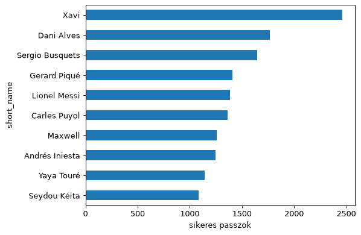

**Hisztogram** — egy mennyiség eloszlása

```python
plt.hist(goals.elapsed_seconds / 60, bins=range(0, 106, 15))
plt.xlabel("perc"); plt.ylabel("gólok"); plt.show()
```

**Eredmény:**

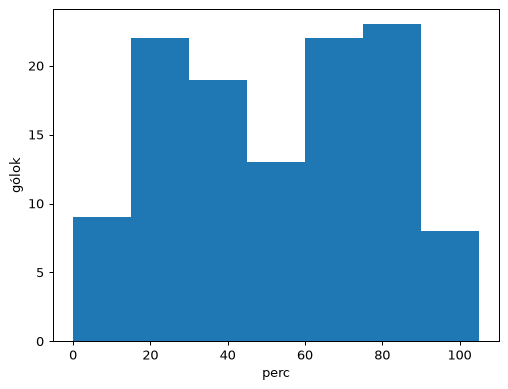

**Pontdiagram** — két mennyiség kapcsolata, csoportonként más színnel (Barcelona meccsei, eredmény szerint)

```python
b = summary[summary.team == "Barcelona"]
for res, color in [("W", "tab:green"), ("D", "tab:orange"), ("L", "tab:red")]:
    g = b[b.result == res]
    plt.scatter(g.passes_completed, g.shots, c=color, label=res, s=50)
plt.xlabel("sikeres passzok"); plt.ylabel("lövések"); plt.legend(); plt.show()
```

**Eredmény:**

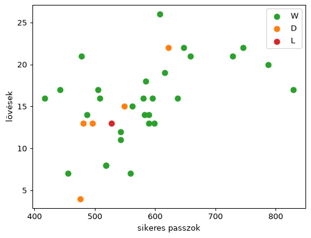

**Idősor** — passzok száma 5 percenként egy meccsen

```python
m = full[full.match_id == 69210]
for team, g in m.groupby("team"):
    plt.hist(g.elapsed_seconds / 60, bins=range(0, 100, 5), histtype="step", lw=2, label=team)
plt.xlabel("perc"); plt.ylabel("passz / 5 perc"); plt.legend(); plt.show()
```

**Eredmény:**

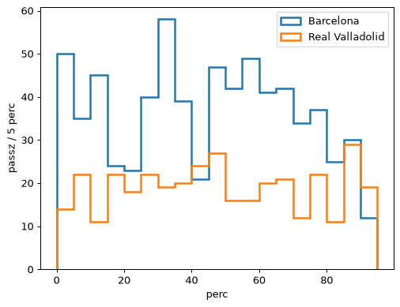

**Doboz-diagram** — csoportok összehasonlítása

```python
summary[summary.team == "Barcelona"].boxplot(column="pass_share", by="points")
plt.suptitle(""); plt.show()
```

**Eredmény:**

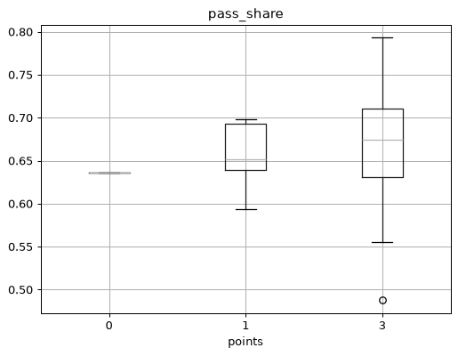

**Több ábra egymás mellett**

```python
fig, axs = plt.subplots(1, 2, figsize=(10, 4))
axs[0].hist(goals.elapsed_seconds / 60, bins=range(0, 106, 15)); axs[0].set_title("gólok ideje")
axs[1].scatter(summary.shots, summary.goals_for);                axs[1].set_title("lövés és gól")
plt.tight_layout(); plt.show()
```

**Eredmény:**

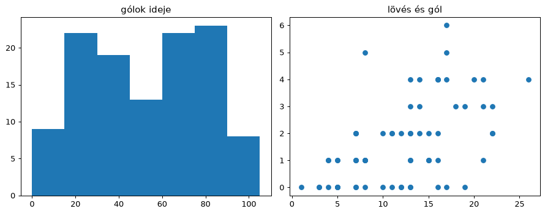

Mentés fájlba: `plt.savefig("abra.png", dpi=150)` a `plt.show()` előtt.

## 3. Ábrák a pályán

A koordináták 0 és 100 között vannak, az `x` a támadás iránya. A `draw_pitch` a 0. szakaszban van.

**Lövések egy meccsen** (sárga = gól)

```python
s = shots[shots.match_id == 69210]
fig, ax = plt.subplots(figsize=(8, 5))
draw_pitch(ax)
ax.scatter(s.x, s.y, c=np.where(s.is_goal, "gold", "tab:blue"), s=60, edgecolor="k")
plt.show()
```

**Eredmény:**

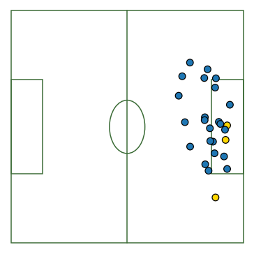

**Hőtérkép** — honnan passzol a Barcelona?

```python
g = passes[passes.team == "Barcelona"]
fig, ax = plt.subplots(figsize=(8, 5))
draw_pitch(ax)
ax.hist2d(g.x1, g.y1, bins=[20, 12], range=[[0, 100], [0, 100]], cmap="Reds", alpha=.8)
plt.show()
```

**Eredmény:**

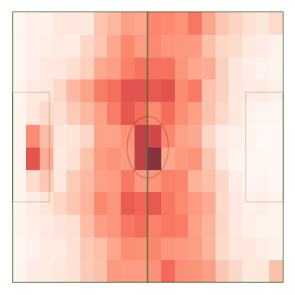

A középkör sötét foltja a kezdőrúgás, a kapu előtti a kapusok kirúgása.

## 4. Hálózatok: networkx alapok

Gráf = csúcsok (játékosok) és élek (passzok). Az élsúly a passzok száma.

**Gráf felépítése**

```python
p = passes[(passes.match_id == 69210) & (passes.team == "Barcelona")]
w = p.groupby(["player_1", "player_2"]).size().rename("weight").reset_index()   # (honnan, hová, súly)
G = nx.from_pandas_edgelist(w, "player_1", "player_2", "weight", create_using=nx.DiGraph)

print(G.number_of_nodes(), G.number_of_edges())
print(pd.Series(dict(G.out_degree(weight="weight"))).sort_values(ascending=False))   # ki hány passzt adott le
```

**Eredmény:**

```text
11 91
Xavier Hernández Creus            85
Daniel Alves da Silva             72
Andrés Iniesta Luján              69
Eric-Sylvain Bilal Abidal         64
Gerard Piqué Bernabéu             62
Seydou Kéita                      58
Carles Puyol i Saforcada          51
Víctor Valdés Arribas             41
Lionel Andrés Messi Cuccittini    34
Thierry Henry                     27
Zlatan Ibrahimović                27
dtype: int64
```

**Egyszerű rajz**

```python
widths = [d["weight"] / 5 for *_, d in G.edges(data=True)]
nx.draw(G, labels={n: short(n) for n in G}, node_size=900, font_size=7, width=widths)
plt.show()
```

**Eredmény:**

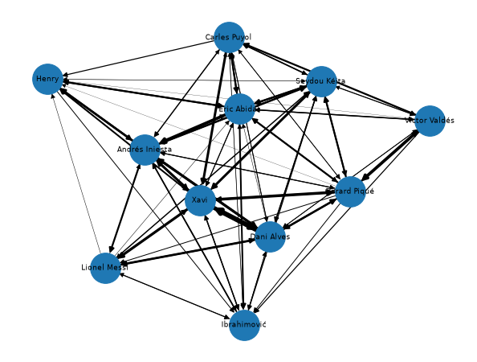

**Hálózat a pályán** — a csúcs helye a játékos átlagos passzkiinduló pontja

```python
pos = p.groupby("player_1")[["x1", "y1"]].mean()
xy  = {n: tuple(pos.loc[n]) for n in G}                     # csúcs -> (x, y)

fig, ax = plt.subplots(figsize=(8, 5))
draw_pitch(ax)
nx.draw_networkx_edges(G, xy, width=widths, alpha=.4, arrows=False, ax=ax)
nx.draw_networkx_nodes(G, xy, node_color="tab:red", ax=ax,
                       node_size=[100 + 8 * G.out_degree(n, weight="weight") for n in G])
nx.draw_networkx_labels(G, xy, labels={n: short(n) for n in G}, font_size=7, font_color="white", ax=ax)
plt.show()
```

**Eredmény:**

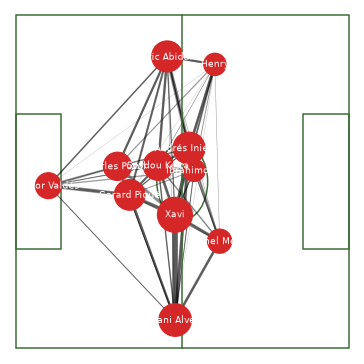

**Fontos csúcsok** (PageRank)

```python
pr = pd.Series(nx.pagerank(G, weight="weight")).sort_values()
pr.rename(short).plot.barh(); plt.show()
```

**Eredmény:**

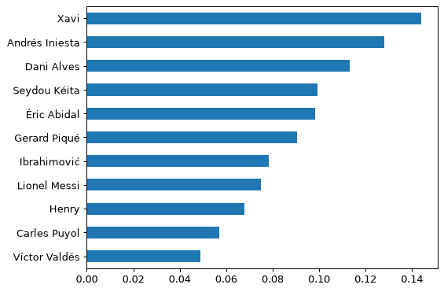

Más mérőszámok: `nx.in_degree_centrality(G)`, `nx.betweenness_centrality(G)`, `nx.eigenvector_centrality(G)`.


## 5. Saját mérőszámok és eredmények

Ha a C++ programotok egy `metrics.csv`-t ír (`match_id,team,total_passes,advance_ratio,...`):

```python
met = pd.read_csv("metrics.csv").merge(summary, on=["match_id", "team"])     # összekapcsolás
print(met[["total_passes", "advance_ratio", "points", "goal_diff"]].corr())
met.boxplot(column="advance_ratio", by="points"); plt.show()
```

**Eredmény:**

```text
               total_passes  advance_ratio    points  goal_diff
total_passes       1.000000       0.903922  0.806706   0.786431
advance_ratio      0.903922       1.000000  0.729951   0.710102
points             0.806706       0.729951  1.000000   0.891549
goal_diff          0.786431       0.710102  0.891549   1.000000
```

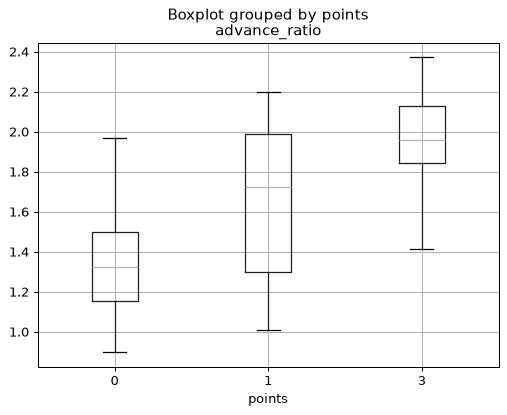

## 6. Regresszió: megjósolható-e az eredmény?

A korreláció azt mondja meg, hogy két mennyiség együtt mozog-e. A regresszió modellt illeszt: a mérőszámokból **megjósolja** a gólkülönbséget. Egy modellt csak olyan adaton szabad kiértékelni, amelyet nem látott, ezért **keresztvalidációt** használunk: a meccseket 5 részre osztjuk, 4 részen tanítunk, az ötödiken tesztelünk, és ezt mind az 5 részre megismételjük. Az `R²` 1 körüli, ha a jóslat jó, 0 körüli, ha nem jobb az átlagnál, és negatív, ha rosszabb.

```python
from sklearn.linear_model import LinearRegression
from sklearn.model_selection import KFold, cross_val_score, cross_val_predict
from sklearn.pipeline import make_pipeline
from sklearn.preprocessing import StandardScaler

rows = []
for (mid, team), p in passes.groupby(["match_id", "team"]):          # egy sor = egy csapat egy meccsen
    w = p.groupby(["player_1", "player_2"]).size().rename("weight").reset_index()
    G = nx.from_pandas_edgelist(w, "player_1", "player_2", "weight", create_using=nx.DiGraph)
    rows.append({"match_id": mid, "team": team, "n_passes": len(p), "density": nx.density(G)})
data = pd.DataFrame(rows).merge(summary[["match_id", "team", "is_barcelona", "goal_diff"]])
data["is_barcelona"] = data.is_barcelona.astype(int)

cv = KFold(5, shuffle=True, random_state=0)                           # 5 véletlen részre osztja a meccseket
for cols in (["n_passes", "density"], ["n_passes", "density", "is_barcelona"]):
    model = make_pipeline(StandardScaler(), LinearRegression())      # standardizálás: az együtthatók összehasonlíthatók
    r2 = cross_val_score(model, data[cols], data.goal_diff, cv=cv, scoring="r2")
    print(cols, "-> R² =", r2.mean().round(2))

model.fit(data[cols], data.goal_diff)
print(dict(zip(cols, model[-1].coef_.round(2).tolist())))            # melyik mérőszám mennyit számít

pred = cross_val_predict(model, data[cols], data.goal_diff, cv=cv)    # minden meccsre olyan modell jóslata, amely nem látta
plt.scatter(pred, data.goal_diff, c=data.is_barcelona.map({1: "tab:red", 0: "tab:gray"}))
plt.plot([-4, 5], [-4, 5], "k--")                                    # tökéletes jóslat: ezen a vonalon lennének a pontok
plt.xlabel("jósolt gólkülönbség"); plt.ylabel("valódi gólkülönbség"); plt.show()
```

**Eredmény:**

```text
['n_passes', 'density'] -> R² = 0.6
['n_passes', 'density', 'is_barcelona'] -> R² = 0.6
{'n_passes': 1.07, 'density': -0.42, 'is_barcelona': 1.36}
```

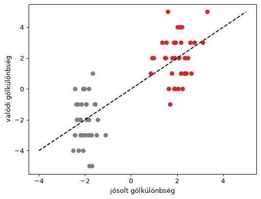

**Óvatosan az értelmezéssel:**
- Az ábrán két felhő van: a piros (Barcelona) fent, a szürke (ellenfelek) lent. A modell nagyrészt azt „tanulta meg”, hogy *melyik csapatról van szó*, nem azt, hogy a passzhálózat mit jelent az eredményre.
- Próbáljátok ki csak a Barcelona meccseivel (`data[data.is_barcelona == 1]`): ott az `R²` gyenge vagy negatív, vagyis a passzszám és a sűrűség egy csapaton belül alig jósol.
- Az együtthatók akkor hasonlíthatók össze, ha a mérőszámokat standardizáltuk (ezt a `StandardScaler` teszi).
- Kevés meccs van (35 Barça-meccs), ezért kevés mérőszámot használjatok, különben a modell túlilleszkedik.
- A jóslat nem ok-okozat: lehet, hogy a vezető csapat passzol többet, nem fordítva.

---

## Ötletek a kísérletezéshez

- Győzelem, döntetlen és vereség esetén más a hálózat? Melyik mérőszám jósolja meg legjobban az eredményt?
- Hazai és idegenbeli meccsek (`is_home`): változik a centroid vagy a tempó?
- Real Madrid elleni meccsek (`69259`, `69262`) és a többi összehasonlítása.
- Hogyan változik a játék gól után (`goals.csv`)? Hogyan reagál a hálózat cserére vagy lapra (`key_events.csv`)?
- Melyik passztípus vezet lövéshez (`play_pattern`, `pass_type` a `passes_full.csv`-ben)?
- Mennyire hatékony a lövés (gól/lövés Barçánál és az ellenfeleknél, játékosonként)?
- Mennyire függ a hálózat Xavitól? Töröljétek a csúcsot (`G.remove_node`), és számoljátok újra a mérőszámokat.
- Csúszóablak (50 passz) a kiterjesztés feladathoz: `full[...].sort_values(["period", "elapsed_seconds"])`, majd `rolling(50)`.


